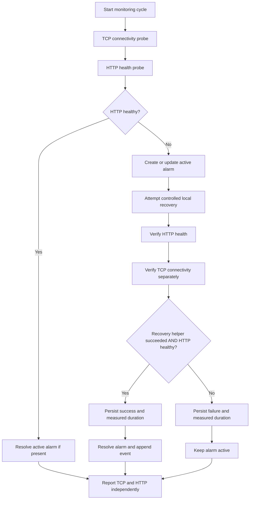

# Architecture and workflow

## Components

`network_monitor` provides separate TCP and HTTP probes. TCP measures whether a socket can be opened. HTTP requests the configured health endpoint and accepts only HTTP 200 with a JSON object whose `status` is `healthy`. Each probe reports a measured response time, timestamp, status, and diagnostic label/error.

`MonitoringController` runs both checks, sends the HTTP result to `AlarmManager`, and attempts recovery only when HTTP reports `DOWN`. It records the recovery attempt after a second HTTP check. Overall recovery is successful only when the recovery helper succeeds and HTTP verifies healthy. TCP verification is reported separately and cannot resolve an alarm by itself.

`AlarmManager` keeps the active alarm lookup and coordinates lifecycle updates. `DatabaseManager` owns the SQLite connection context manager and parameterized statements. Each operation commits on success, rolls back on exceptions, and closes its connection in `finally`. Historical alarm/event rows are append-preserved; resolution updates an alarm and inserts a lifecycle event rather than deleting history.

The Flask dashboard composes existing monitoring and persistence components. Its `GET /` route performs read-only health probes and database reads. Its token-protected `POST /check` route is the explicit action that runs `MonitoringController` and can attempt recovery. A refresh alone never runs recovery.

## Monitoring and recovery sequence

The recovery helper can launch only `app/monitoring/test_service.py` on a local loopback target. If TCP is already reachable but HTTP is unhealthy, it does not claim that a restart succeeded. The controller keeps the alarm active and records the unsuccessful recovery outcome.

## SQLite data model

### `alarms`

| Column | Meaning |
| --- | --- |
| `id` | Primary key |
| `target` | Host and port label |
| `severity` | Alarm severity (currently `CRITICAL`) |
| `status` | `ACTIVE` or `RESOLVED` |
| `first_seen`, `last_seen` | First and most recent failure timestamps (UTC ISO text) |
| `occurrences` | Number of checks that observed the active failure |
| `details` | Diagnostic label and error text |
| `resolved_at` | Resolution timestamp, if resolved |
| `recovery_success` | `1`, `0`, or `NULL` when no recovery was recorded |
| `recovery_duration` | Measured duration in seconds, stored as SQLite `REAL` |

### `incident_events`

Each event has an `id`, optional `alarm_id` foreign key, target, `event_type`, description, and UTC timestamp. Current events include alarm creation, repeated failure updates, and resolution. Events are retained as history and are not reset when alarms resolve.

## Fault classification

Classification is deterministic and intentionally modest:

- `CONNECTION_REFUSED`: socket or HTTP connection reports a refused connection.
- `TIMEOUT`: TCP or HTTP operation times out.
- `CONNECTION_ERROR`: another connection-level failure.
- `HTTP_ERROR`: health endpoint returns a non-200 response.
- `INVALID_HEALTH_RESPONSE`: response body is not valid JSON or not a JSON object.
- `UNHEALTHY_RESPONSE`: valid JSON does not contain `status: healthy`.

These labels help operators interpret an incident; they do not establish a deep causal explanation. The raw error or response diagnosis is retained in the alarm details.

## Configuration and operational boundaries

Configuration uses environment variables documented in the repository README. The default database path is `network_healing.db` at the project root. The dashboard binds to loopback unless explicitly configured otherwise. The dashboard session key is generated per process when `DASHBOARD_SECRET_KEY` is not set; configure a stable secret if sessions need to survive restarts.

The current design is an on-demand, single-process demonstration using SQLite. It has no scheduler, distributed lock, authentication system, or production service manager integration. Keep the dashboard on localhost unless deployment security controls are added.
